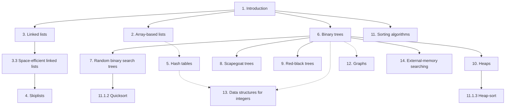

# EDUCATIVE.IO 

## Link:
[educative.io](https://www.educative.io/courses/data-structures-with-generic-types-in-cpp/)

## Prerequisites

This is not a beginner-level course. It won’t explain the basic syntax of the programming language used in the course. 
If you see a piece of code that works but doesn’t look familiar, please consider it an opportunity to learn something new 
by utilizing your ability to explore.

## Number of operations

Imagine an application with a moderately-sized data set, say of one million ($10^6$) items. In most applications, it is reasonable to assume that the application will want to look up each item at least once. This means we can expect to do at least one million ($10^6$) searches in this data. If each of these $10^6$ searches inspects each of the $10^6$ items, this gives a total of:

$$10^6 \times 10^6 = 10^{12} \text{ (one thousand billion) inspections}$$

## Processor speeds

At the time of writing, even a very fast desktop computer cannot do more than one billion ($10^9$) operations per second. This means that this application will take at least:

$$\frac{10^{12}}{10^9} = 1000 \text{ seconds}$$

or roughly $16$ minutes and $40$ seconds. Sixteen minutes is an eon in computer time, but a person might be willing to put up with it (if they were headed out for a coffee break).

> **Note:** Computer speeds are at most a few gigahertz (billions of cycles per second), and each operation typically takes a few cycles.

## Bigger data sets

Now consider a company like Google, that indexes over $8.5$ billion web pages. By our calculations, doing any query over this data would take at least $8.5$ seconds. We already know that this isn’t the case; web searches complete in much less than $8.5$ seconds, and they do much more complicated queries than just asking if a particular page is in their list of indexed pages.

At the time of writing, Google receives approximately $4,500$ queries per second, meaning that they would require at least:

$$4,500 \times 8.5 = 38,250 \text{ very fast servers just to keep up}$$

## The solution

These examples tell us that the obvious implementations of data structures do not scale well when the number of items, $n$, in the data structure and the number of operations, $m$, performed on the data structure are both large. In these cases, the time (measured in, say, machine instructions) is roughly $n \times m$.

The solution, of course, is to carefully organize data within the data structure so that not every operation requires every data item to be inspected. Although it sounds impossible at first, there are data structures where a search requires looking at only two items on average, independent of the number of items stored in the data structure. In our billion instruction per second computer, it takes only:

$$0.000000002 \text{ seconds}$$

to search in a data structure containing a billion items (or a trillion, or a quadrillion, or even a quintillion items).

There are such data structures that keep the items in sorted order, where the number of items inspected during an operation grows very slowly as a function of the number of items in the data structure. For example, we can maintain a sorted set of one billion items while inspecting at most $60$ items during any operation. In our billion instruction per second computer, these operations take:

$$0.00000006 \text{ seconds each}$$

# Exponentials and Logarithms

The expression $b^x$ denotes the number $b$ raised to the power of $x$. If $x$ is a positive integer, then this is just the value of $b$ multiplied by itself $x$ times:

$$b^x = \underbrace{b \times b \times \cdots \times b}_{x \text{ times}}$$

When $x$ is a negative integer, $b^x = 1/b^{-x}$. When $x = 0$, $b^x = 1$. When $b$ is not an integer, we can still define exponentiation in terms of the exponential function $e^x$ (see below), which is itself defined in terms of the exponential series, but this is best left to a calculus text.

In this course, the expression $\log_b k$ denotes the base-$b$ logarithm of $k$. That is, the unique value $x$ that satisfies

$$b^x = k$$

Most of the logarithms in this course are base 2 (binary logarithms). For these, we omit the base, so that $\log k$ is shorthand for $\log_2 k$.

An informal, but useful, way to think about logarithms is to think of $\log_b k$ as the number of times we have to divide $k$ by $b$ before the result is less than or equal to $1$. For example, when a binary search is done, each comparison reduces the number of possible answers by a factor of $2$. This is repeated until there is at most one possible answer. Therefore, the number of comparisons done by binary search, when there are initially at most $n + 1$ possible answers, is at most $\lceil \log_2(n + 1) \rceil$.

Another logarithm that comes up several times in this course is the natural logarithm. Here we use the notation $\ln k$ denotes $\log_e k$, where $e$—Euler's constant—is given by

$$e = \lim_{n \to \infty} \left(1 + \frac{1}{n}\right)^n \approx 2.71828$$

The natural logarithm comes up frequently because it is the value of a particularly common integral:

$$\int_1^k \frac{1}{x} \, dx = \ln k$$

Two of the most common manipulations we do with logarithms are removing them from an exponent:

$$b^{\log_b k} = k$$

and changing the base of a logarithm:

$$\log_b k = \frac{\log_a k}{\log_a b}$$

For example, we can use these two manipulations to compare the natural and binary logarithms:

$$\ln k = \frac{\log k}{\log e} = \frac{\log k}{(\ln e) / (\ln 2)} = (\ln 2)(\log k) \approx 0.693147 \log k$$

## Factorials

In one or two places in this course, the **factorial function** is used. For a non-negative integer $n$, the notation $n!$ (pronounced "$n$ factorial") is defined to mean

$$n! = 1 \cdot 2 \cdot 3 \cdot \cdots \cdot n$$

Factorials appear because $n!$ counts the number of distinct permutations, i.e., orderings, of $n$ distinct elements. For the special case $n = 0$, $0!$ is defined as $1$.

The quantity $n!$ can be approximated using **Stirling’s Approximation**:

$$n! = \sqrt{2\pi n} \left(\frac {n}{e}\right)^n e^{\alpha(n)}$$

where

$$\frac{1}{12n + 1} < \alpha (n) < \frac{1}{12n}$$

Stirling’s Approximation also approximates $\ln(n!)$:

$$\ln (n!) = n \ln n - n + \frac{1}{2} \ln (2\pi n) + \alpha(n)$$

> **Note:** In fact, Stirling’s Approximation is most easily proven by approximating $\ln (n!) = \ln 1 + \ln 2 + \cdots + \ln n$ by the integral $\int_{1}^{n} \ln n\ dn = n \ln n - n + 1$.

Related to the factorial function are the **binomial coefficients**. For a non-negative integer $n$ and an integer $k \in \{0,...,n\}$, the notation $\binom{n}{k}$ denotes:

$$\binom{n}{k} = \frac {n!} {k!(n-k)!}$$

The binomial coefficient $\binom{n}{k}$ (pronounced "$n$ factorial $k$") counts the number of subsets of an $n$ element set that have size $k$, i.e., the number of ways of choosing $k$ distinct integers from the set $\{1,...,n\}$.

## Asymptotic notation

When we talk about the running time of an operation, we are referring to the number of computer instructions performed during the operation. Even for simple code, this quantity can be difficult to compute exactly. Therefore, instead of analyzing running times exactly, we’ll use the so-called big-Oh notation: For a function $f(n)$, $O(f(n))$ denotes a set of functions,

$$O(f(n)) = \begin{cases} g(n) : \text{there exists } c > 0 \text{ and } n_0 \text{ such that}\\ g(n) \le c \cdot f(n) \text{ for all } n \ge n_0 \end{cases}$$

Thinking graphically, this set consists of the functions $g(n)$ where $c \cdot f(n)$ starts to dominate $g(n)$ when $n$ is sufficiently large.

We generally use asymptotic notation to simplify functions. For example, in place of $5n \log n + 8n - 200$ we can write $O(n \log n)$. This is proven as follows:

$$5n \log n + 8n - 200 \le 5n \log n + 8n$$

$$\le 5n \log n + 8n \log n \quad \text{for } n \ge 2 \text{ (so that } \log n \ge 1)$$

$$\le 13n \log n$$

This demonstrates that the function $f(n) = 5n \log n + 8n - 200$ is in the set $O(n \log n)$ using the constants $c = 13$ and $n_0 = 2$.

A number of useful shortcuts can be applied when using asymptotic notation. First:

$$O(n^{c_1}) \subset O(n^{c_2})$$

for any $c_1 < c_2$. Second: For any constants $a, b, c > 0$,

$$O(a) \subset O(\log n) \subset O(n^b) \subset O(c^n)$$

These inclusion relations can be multiplied by any positive value, and they still hold. For example, multiplying by $n$ yields:

$$O(n) \subset O(n \log n) \subset O(n^{1+b}) \subset O(nc^n)$$

Continuing in a long and distinguished tradition, we’ll use $f_1(n) = O(f(n))$ and $f_1(n) \in O(f(n))$ synonymously. We will also make statements like “the running time of this operation is $O(f(n))$” when this statement should be “the running time of this operation is a member of $O(f(n))$.”

A particularly strange example of this occurs when we write statements like:

$$T(n) = 2 \log n + O(1)$$

Again, this would be more correctly written as:

$$T(n) \le 2 \log n + [\text{some member of } O(1)]$$

The expression $O(1)$ also brings up another issue. Since there is no variable in this expression, it may not be clear which variable is getting arbitrarily large. Without context, there is no way to tell. In the example above, since the only variable in the rest of the equation is $n$, we can assume that this should be read as $T(n) = 2 \log n + O(f(n))$, where $f(n) = 1$.

Big-Oh notation is not new or unique to computer science. It was used by the number theorist Paul Bachmann as early as 1894, and is immensely useful for describing the running times of computer algorithms. Consider the following piece of code:

```java
void snippet() {
  for (int i = 0; i < n; i++)
    a[i] = i; 
}

```

One execution of this method involves:
- $1$ assignment (`int i = 0`)
- $n+1$ comparisons (`i < n`)
- $n$ increments (`i++`)
- $n$ array offset calculations (`a[i]`)
- $n$ indirect assignments (`a[i] = i`)

So we could write this running time as:

$$T(n) = a + b(n+1) + cn + dn + en$$

where $a, b, c, d,$ and $e$ are machine-dependent constants. Using big-Oh notation, this simplifies cleanly to:

$$T(n) = O(n)$$

# Approach and Coverage

Explore the methodology and coverage of key data structures in C++, focusing on simplified code samples and performance metrics. Understand the design choices for interfaces and efficiency to build foundational knowledge for implementing and analyzing data structures in C++.

## Methodology

The code samples in this course are written in the C++ programming language. However, to make the course accessible to readers not familiar with all of C++ constructs and keywords, the code samples have been simplified. For example, a reader won’t find any of the keywords `public`, `protected`, `private`, or `static`. A reader also won’t find much discussion about class hierarchies. Which interfaces a particular class implements or which class it extends, if relevant to the discussion, should be clear from the accompanying text.

These conventions should make the code samples understandable by anyone with a background in any of the languages from the ALGOL tradition, including B, C, C++, C#, Objective-C, D, Java, JavaScript, and so on. Readers who want the full details of all implementations are encouraged to look at the C++ source code that accompanies this course.

This course mixes mathematical analyses of running times with C++ source code for the algorithms being analyzed. This means that some equations contain variables also found in the source code. These variables are typeset consistently, both within the source code and within equations. The most common such variable is the variable $n$ that, without exception, always refers to the number of items currently stored in the data structure.

## List of Data Structures

The tables below summarize the performance of data structures in this course that implement each of the interfaces, `List`, `USet`, and `SSet`, described previously.

### Summary of List and USet Implementations

#### List Implementations

| Data Structure | `get(i)` / `set(i, x)` | `add(i, x)` / `remove(i)` |
| :--- | :--- | :--- |
| `ArrayStack` | $O(1)$ | $O(1 + n - i)^A$ |
| `ArrayDeque` | $O(1)$ | $O(1 + \min\{i, n - i\})^A$ |
| `DualArrayDeque` | $O(1)$ | $O(1 + \min\{i, n - i\})^A$ |
| `RootishArrayStack` | $O(1)$ | $O(1 + n - i)^A$ |
| `DLList` | $O(1 + \min\{i, n - i\})$ | $O(1 + \min\{i, n - i\})$ |
| `SEList` | $O(1 + \min\{i, n - i\} / b)$ | $O(b + \min\{i, n - i\} / b)^A$ |
| `SkiplistList` | $O(\log n)^E$ | $O(\log n)^E$ |

#### USet Implementations

| Data Structure | `find(x)` | `add(x)` / `remove(x)` |
| :--- | :--- | :--- |
| `ChainedHashTable` | $O(1)^E$ | $O(1)^{A, E}$ |
| `LinearHashTable` | $O(1)^E$ | $O(1)^{A, E}$ |

- $^A$ Denotes an **amortized** running time.
- $^E$ Denotes an **expected** running time.

---

### Summary of SSet and Priority Queue Implementations

#### SSet Implementations

| Data Structure | `find(x)` | `add(x)` / `remove(x)` |
| :--- | :--- | :--- |
| `SkiplistSSet` | $O(\log n)^E$ | $O(\log n)^E$ |
| `Treap` | $O(\log n)^E$ | $O(\log n)^E$ |
| `ScapegoatTree` | $O(\log n)$ | $O(\log n)^A$ |
| `RedBlackTree` | $O(\log n)$ | $O(\log n)$ |
| `BinaryTrie`$^I$ | $O(w)$ | $O(w)$ |
| `XFastTrie`$^I$ | $O(\log w)^{A, E}$ | $O(w)^{A, E}$ |
| `YFastTrie`$^I$ | $O(\log w)^{A, E}$ | $O(\log w)^{A, E}$ |
| `BTree` | $O(\log n)$ | $O(B + \log n)^A$ |
| `BTree`$^X$ | $O(\log_B n)$ | $O(\log_B n)$ |

#### (Priority) Queue Implementations

| Data Structure | `findMin()` | `add(x)` / `remove()` |
| :--- | :--- | :--- |
| `BinaryHeap` | $O(1)$ | $O(\log n)^A$ |
| `MeldableHeap` | $O(1)$ | $O(\log n)^E$ |

- $^I$ This structure can only store $w$-bit integer data.
- $^X$ This denotes the running time in the external-memory model.

---

## Module Relationships

The following illustration shows the dependencies between various modules in this course. A solid arrow shows a strong dependency of a module on another. A dashed arrow indicates only a weak dependency, in which only a small part of the module depends on another module or only the main results of the other module.


